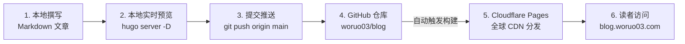

# woruo03's Blog — 个人技术博客

这是我的个人技术博客仓库，主要记录 Linux、嵌入式硬件和计算机日常学习笔记。

线上地址：[https://blog.woruo03.com](https://blog.woruo03.com)

---

## 🛠 技术架构速览

博客采用静态网站架构，不需要维护独立服务器：



- **生成引擎**：[Hugo](https://gohugo.io/) Extended（静态站点构建）
- **前端主题**：[Blowfish](https://blowfish.page/)（Tailwind CSS，支持深色模式、零重排阅读进度条、智能大纲折叠、专注阅读模式、设置面板、GitHub 源码直达编辑、社交分享、`llms.txt` AI 索引、KaTeX 公式与代码复制）
- **部署平台**：[Cloudflare Pages](https://pages.cloudflare.com/)（自动 CI/CD 与 HTTPS，静态资源及 `/img/*` 边缘长缓存）
- **统计与点赞**：[Cloudflare D1](https://developers.cloudflare.com/d1/)（Serverless SQLite 边缘数据库，每日 10 万次写 / 500 万次读免费额度）
- **评论系统**：[Giscus](https://giscus.app/)（基于 GitHub Discussions，免数据库）

---

## 📖 新手日常写作与发布全流程（保姆级教程）

日常写作和发布分为三步：写文章、本地预览、推送上线。

### 第一步：新建一篇文章

文章建议按 Page Bundle（独立文件夹）存放，每篇文章的正文和配图放在同一个目录里，方便管理。

在博客根目录下打开终端，执行：

```bash
# 例如新建一篇关于 Linux 常用命令的文章（文件夹名建议用英文/拼音）
hugo new posts/linux-basic-commands/index.md
```

这会在 `content/posts/linux-basic-commands/` 下生成一个 `index.md` 文件。

> 提示：也可以不用命令，直接在 `content/posts/` 下手动新建文件夹（如 `my-post`）并创建 `index.md`。

---

### 第二步：编辑文章与插入图片

#### 1. 文章头部信息（Front Matter）详解

打开 `index.md`，顶部由两条 `---` 包裹的区域是 Front Matter（文章元数据），Hugo 通过它读取标题、发布日期、分类、大纲和草稿状态。

##### ① 极简常用模板（日常写作 90% 场景，直接复制即用）

```yaml
---
title: "我的 Linux 常用命令学习笔记" # [必填] 文章标题
date: 2026-11-13 # [必填] 发布日期 (YYYY-MM-DD)
description: "记录日常使用最频繁的 Linux 命令" # [推荐] 文章摘要，用于首页列表展示与搜索
tags: ["Linux", "学习笔记"] # [可选] 标签（支持多个）
categories: ["技术笔记"] # [可选] 分类目录
draft: false # [重要] 是否为草稿（正式发布必须为 false！）
showTableOfContents: true # [推荐] 是否在右侧显示大纲目录（推荐 true）
---
```

##### ② 全功能进阶模板（支持系列专栏连载、封面图与排版调控）

```yaml
---
title: "从零开始搭建嵌入式 Linux 开发环境"
date: 2026-11-13
lastmod: 2026-11-14 # 文章最后更新时间（网页上会标注“更新于某天”）
description: "详细记录交叉编译工具链配置与 QEMU 模拟踩坑记录"
tags: ["Linux", "嵌入式", "QEMU"]
categories: ["嵌入式实战"]
series: ["嵌入式开发实战"] # 系列专栏名称（同系列文章会自动串联）
series_order: 1 # 本篇在系列专栏中的第几篇
draft: false # 正式发布
showTableOfContents: true # 开启右侧大纲
showZenMode: true # 开启专注模式按钮（点击可折叠大纲加宽正文）
showComments: true # 是否开启文末评论区（默认 true）
featureimage: "https://img.woruo03.com/posts/example/cover.webp" # 封面大图外链或本地文件名（有图则显、无图不显）
imagePosition: "50% 20%" # 二次元人物建议设为 50% 20% 或 top，避免裁掉头部
slug: "embedded-linux-setup" # 自定义文章 URL 网址后缀
---
```

##### ③ Front Matter 常用参数速查表

| 参数名                |  类型  | 推荐设置 | 说明                                                                                                      |
| :-------------------- | :----: | :------: | :-------------------------------------------------------------------------------------------------------- |
| `title`               | 字符串 |   必填   | 文章标题，展示在文章页面最顶部、首页卡片及浏览器标签栏。                                                  |
| `date`                |  日期  |   必填   | 初始创建与发布日期，推荐格式：`YYYY-MM-DD`。                                                              |
| `lastmod`             |  日期  |   可选   | 最后修改日期。若修改了旧文章，加上此项会在标题下显示“更新于...”。                                         |
| `description`         | 字符串 | 推荐填写 | 文章简短介绍，在文章卡片列表、社交分享卡片以及搜索结果中展示。                                            |
| `tags`                |  数组  |   可选   | 标签列表，如 `["Linux", "C语言"]`，读者点击标签可查阅同主题文章。                                         |
| `categories`          |  数组  |   可选   | 分类目录，如 `["学习笔记"]`。                                                                             |
| `draft`               |  布尔  | `false`  | 草稿标记。`true` 仅本地可见，`false` 才会正式推送到公网上线。                                             |
| `showTableOfContents` |  布尔  |  `true`  | 右侧大纲目录开关。长文建议 `true`；若文章简短想让正文直接居中，设为 `false`。                             |
| `showZenMode`         |  布尔  |  `true`  | 专注阅读模式开关。标题旁显示“全屏展开”按钮，读者点击可折叠大纲并加宽正文。                                |
| `showComments`        |  布尔  |  `true`  | 评论区开关。设为 `false` 可单独关闭本篇文章底部的评论区。                                                 |
| `series`              |  数组  |   可选   | 系列专栏名称，如 `series: ["Linux 基础系列"]`。同系列文章会自动串联展示前后篇章。                         |
| `series_order`        |  数字  |   可选   | 本篇在系列专栏中的序号（如 `1`、`2`）。                                                                   |
| `featureimage`        | 字符串 |   可选   | 文章封面图 URL（如 R2 `https://img.woruo03.com/...`）或同目录文件名；有图才显示顶部背景封面，无图不占位。 |
| `imagePosition`       | 字符串 |   可选   | 背景封面裁剪焦点（如 `"50% 20%"`、`top`），二次元人物插画建议设为 `"50% 20%"`。                           |
| `featureimagecaption` | 字符串 |   可选   | 前景「大图」模式下显示的图注（支持 Markdown，如画师出处链接）。                                           |
| `hideFeatureImage`    |  布尔  |   可选   | 设为 `true` 时仅在文章页显示顶部封面，不在首页/列表卡片展示缩略图。                                       |
| `slug`                | 字符串 |   可选   | 自定义当前文章的网页链接后缀（如 `slug: "my-first-post"`）。                                              |

##### ④ 核心机制深度解析

> [!IMPORTANT]
> `draft: false` 与 `draft: true` 的区别：
>
> - `draft` 表示“草稿”。
> - `draft: true` 时，Cloudflare Pages 执行生产构建会忽略该文章，即使已经推送到 GitHub，公网访客也看不到；只有在本地运行 `hugo server -D`（`--buildDrafts`）时才能预览。
> - `draft: false` 时，推送到 GitHub 后 Cloudflare Pages 会正常构建发布。准备上线时需要将 `draft` 改为 `false`。

> [!TIP]
> 折叠大纲或为正文留出更多宽度的方法：
>
> - 方式一（动态切换）：博客已全局开启专注模式（Zen Mode），点击文章标题旁的全屏展开按钮即可隐藏右侧大纲并加宽正文，适合阅读宽屏代码和表格；再次点击可恢复原布局。
> - 方式二（单篇关闭）：短篇随笔不需要目录时，可在文章开头设置 `showTableOfContents: false`，关闭右侧大纲栏让正文居中。

> 数学公式提示：文章包含数学公式时，请在正文第一行加上 ``（实际使用时去掉 `/* */`，写作 ``）。

---

#### 2. 如何插入本地图片

文章需要配图时：

1. 将图片（例如 `screenshot.png`）放到该文章的文件夹里（与 `index.md` 同级）。
2. 在 Markdown 正文里引用：
    ```markdown
    
    ```

图片会由 Hugo 自动识别和优化，不需要写复杂路径。

#### 3. 语法速查（不知道怎么写时）

仓库里自带一篇语法展示文章 `content/posts/hello-world/index.md`，需要用到公式、流程图、彩色/可折叠提示框、多平台 `tabs` 标签页、`steps` 分步时间线、`accordion` 折叠问答、站内文章卡片或防爬虫 `email` 链接时，可以直接从里面复制。

---

### 第三步：本地实时预览（看效果）

写作过程中，可以在本地启动预览服务查看排版效果：

```bash
# 在博客根目录下运行
hugo server -D
```

终端会输出以下提示：

```
Web Server is available at http://localhost:1313/ (bind address 127.0.0.1)
Press Ctrl+C to stop
```

1. 打开浏览器访问 `http://localhost:1313`。
2. 在编辑器按 <kbd>Ctrl</kbd> + <kbd>S</kbd> 保存后，浏览器页面会在 0.1 秒内自动刷新。
3. 预览结束后，在终端按 <kbd>Ctrl</kbd> + <kbd>C</kbd> 退出本地服务。

---

### 第四步：一键推送到网页（发布上线）

确认排版没问题后，执行三条 Git 命令发布：

```bash
# 1. 保存并暂存所有修改
git add .

# 2. 记录本次更新内容（写清楚这次更新了什么）
git commit -m "发布新文章：Linux 常用命令学习笔记"

# 3. 推送到 GitHub 仓库
git push
```

推送后流程：

- GitHub 收到更新后会自动触发 Cloudflare Pages 构建。
- Cloudflare Pages 通常在约 1 分钟左右完成编译并刷新 CDN 缓存。
- 访问 [https://blog.woruo03.com](https://blog.woruo03.com) 即可看到新文章。

---

## ⚙️ 常见操作与修改指南

### 1. 如何更换头像并同步所有图标？

1. 准备一张正方形图片，重命名为 `avatar.png`。
2. 替换掉 `assets/img/avatar.png`。
3. 在终端运行下面的脚本，会基于新头像生成站内 WebP 头像（`assets/img/avatar.webp`）、默认社交分享图（`assets/img/og-default.png`），以及浏览器 Favicon、Apple Touch Icon 和 Android Chrome 图标：
    ```bash
    python3 -c "
    from PIL import Image
    with Image.open('assets/img/avatar.png') as img:
        img_rgba = img.convert('RGBA')
        img_rgba.resize((576, 576), Image.Resampling.LANCZOS).save('assets/img/avatar.webp', format='WEBP', quality=85, method=6)
        bg = Image.new('RGB', img.size, (255, 255, 255))
        bg.paste(img_rgba, mask=img_rgba.split()[3])
        bg.resize((512, 512), Image.Resampling.LANCZOS).save('assets/img/og-default.png', format='PNG', optimize=True)
        img_rgba.resize((512, 512), Image.Resampling.LANCZOS).save('static/android-chrome-512x512.png')
        img_rgba.resize((192, 192), Image.Resampling.LANCZOS).save('static/android-chrome-192x192.png')
        img_rgba.resize((180, 180), Image.Resampling.LANCZOS).save('static/apple-touch-icon.png')
        img_rgba.resize((32, 32), Image.Resampling.LANCZOS).save('static/favicon-32x32.png')
        img_rgba.resize((16, 16), Image.Resampling.LANCZOS).save('static/favicon-16x16.png')
        img_rgba.resize((48, 48), Image.Resampling.LANCZOS).save('static/favicon.ico', sizes=[(16,16),(32,32),(48,48)])
    print('✓ 所有头像、OG 图与图标同步更新完毕！')
    "
    ```
4. 提交并推送到 GitHub 即可。

### 2. 如何修改“关于我”页面？

打开 `content/about/index.md`，直接修改里面的 Markdown 文字即可。

### 3. 如何修改首页作者简介与社交链接？

打开 `config/_default/languages.zh-cn.toml`：

- `headline`：头像下方的短标语。
- `bio`：自我介绍描述。
- `links`：可自由添加或修改 GitHub、邮箱、B站等链接。

### 4. 如何使用 Giscus 评论区？

博客已在 `layouts/partials/comments.html` 中配置好仓库 ID 和讨论区参数。开启评论需要确认 GitHub Discussions 已打开：

1. 访问 GitHub 仓库页面：`https://github.com/woruo03/blog`。
2. 进入 **Settings** → 滚动到 **Features** 区域。
3. 勾选 **Discussions**。
4. 在 [GitHub Giscus App](https://github.com/apps/giscus) 安装并授权访问 `woruo03/blog` 仓库。
   开启后，读者就可以在每篇文章底部使用 GitHub 账号留言。

### 5. 如何激活文章浏览量（Views）与点赞（Likes）？

文章统计与点赞基于 **Cloudflare Pages Functions + D1 数据库** 实现，包含阅读门禁、乐观更新、跨标签页同步、边缘内存限流和 WAI-ARIA 无障碍支持。推送代码后，在 Cloudflare 控制台完成一次绑定即可启用（约 2 分钟）：

1. **新建 D1 数据库**：
    - 登录 [Cloudflare 控制台](https://dash.cloudflare.com/) → **Storage & Databases** → **D1**。
    - 点击 **Create database**，输入数据库名（如 `blog-db`），点击确认。
2. **初始化数据表**：
    - 点击进入刚创建的 `blog-db`，进入 **Console**（控制台）标签页。
    - 执行仓库中 `functions/schema.sql` 中的建表语句（首次访问时服务端也会自动检查并建表）：
        ```sql
        CREATE TABLE IF NOT EXISTS stats (
          id TEXT PRIMARY KEY,
          views INTEGER NOT NULL DEFAULT 0,
          likes INTEGER NOT NULL DEFAULT 0,
          updated_at TIMESTAMP DEFAULT CURRENT_TIMESTAMP
        );

        CREATE TABLE IF NOT EXISTS stats_likes_log (
          post_id TEXT NOT NULL,
          client_hash TEXT NOT NULL,
          liked_at INTEGER NOT NULL,
          PRIMARY KEY (post_id, client_hash)
        );
        ```
3. **绑定到 Pages 项目**：
    - 进入 **Compute (Workers) & Pages** → 点击你的博客项目 `blog`。
    - 进入 **Settings** → **Functions** → 下滑到 **D1 database bindings**。
    - 点击 **Add binding**：
        - **Variable name（变量名）**：输入 `DB`
        - **D1 database（数据库）**：选择刚才创建的 `blog-db`
    - 保存后，浏览量统计、去重防刷与点赞功能即生效。

4. **（可选）配置环境变量增强安全**：
    - 在 **Settings** → **Environment variables** 中，可按需添加以下生产环境变量：
        - `STATS_SECRET`：访客匿名哈希的加密盐值（建议填入长随机密钥），用于隔离访客点赞签名与防伪造。
        - `ALLOWED_ORIGINS`：自定义允许 CORS 访问的域名列表（以英文逗号分隔，例如 `https://blog.woruo03.com,https://woruo03.pages.dev`）。默认已允许当前同源、生产主域及 Pages 预览域。

5. **实现细节**：
    - **冷启动与按需建表**：运行时仅在缺表异常时惰性建表，常规请求不执行额外 DDL，冷启动 TTFB 可减少 50~200ms。
    - **减少 D1 写入（约 75%~90%）**：结合客户端 LocalStorage、Cloudflare Edge Cache（Cache API）与安全 Cookie 实现 24 小时边缘去重，单次有效阅读只向主表写入 1 行，省去临时访问日志表和定期清理。
    - **边缘内存限流**：通过 Worker 内存滑动窗口拦截高频刷量请求，不消耗磁盘写入，避免耗尽 D1 免费层每日 100k 写入配额。
    - **阅读门禁**：页面处于可见状态停留满 6 秒，或滚动超过 30% 且停留超过 3.5 秒才上报阅读量，过滤爬虫和误触秒关。
    - **博主免记模式（Admin Bypass）**：访问任意页面携带 `?admin=1`（如 `https://blog.woruo03.com/?admin=1`）可开启免记标记，巡检和调试时不再计入统计（访问 `?admin=0` 恢复）。
    - **乐观更新与 450ms 防抖**：点赞立即切换状态，450ms 内重复点击会合并对冲，请求失败时回退到服务端状态，关窗或锁屏时通过 `keepalive` 补发挂起请求。
    - **无障碍与防抖动**：使用独立的读屏活动区提示点赞结果，配合等宽数字（`tabular-nums`）与骨架屏占位，累积布局偏移（CLS）为 0。

---

### 6. 如何配置 Cloudflare R2 图床（防重复拉取缓存）与二次元封面？

博客已开启全局 `background` 封面（有图则显、无图不显）及 `hotlinkFeatureImage = true`，R2 外链图片在 Hugo 构建期不会回源下载或二次压缩；顶栏右侧的「设置」弹窗支持读者调节沉浸背景开关、背景图浓度（15%～90%）和顶部前景封面（关闭 / 横幅 / 大图）。

为了让图片走 Cloudflare 边缘缓存与浏览器本地强缓存，避免每次请求回源拉取 R2 原图，可在 Cloudflare 控制台完成以下一次配置：

1. **创建 R2 存储桶并绑定自定义域名（勿用 `r2.dev`）**：
    - 进入 Cloudflare Dashboard → **R2 Object Storage** → **Create bucket**（如 `blog-media`）。
    - 进入桶的 **Settings** → **Public access** → **Custom Domains** → **Connect Domain**，绑定 `img.woruo03.com`（会自动生成橙云 Proxied DNS）。
    - 保持 `r2.dev` 开发访问关闭（`r2.dev` 有限速，且不支持 Cloudflare 边缘缓存与 WAF）。
2. **开启 Smart Tiered Cache（减少跨区回源）**：
    - 进入域名 `woruo03.com` → **Caching** → **Tiered Cache** → 开启 **Smart Tiered Cache**（Free 计划免费可用，各地边缘 POP 未命中时会先查离 R2 最近的上层缓存节点）。
3. **配置长缓存规则（Cache Rule）**：
    - 进入 `woruo03.com` → **Caching** → **Cache Rules** → **Create rule**（命名为 `R2 Media Long Cache`）：
        - **When incoming requests match**：选择 **Custom filter expression**，表达式填 `(http.host eq "img.woruo03.com")`
        - **Cache eligibility**：选择 **Eligible for cache**
        - **Edge TTL**：选择 **Ignore cache-control header and use this TTL**，设为 **1 month**
        - **Browser TTL**：选择 **Override origin and use this TTL**，设为 **1 year**
4. **上传图片时附带 `immutable` 缓存头（避免同名覆盖）**：
    - 使用 `rclone` 或 PicList / PicGo（S3 模式）上传时，附带 `Cache-Control: public, max-age=31536000, immutable`：
        ```bash
        rclone copy ./local-images r2:blog-media/posts/my-post \
          --header-upload "Cache-Control: public, max-age=31536000, immutable"
        ```
    - 需要替换已发布的图片时请使用新文件名（例如 `cover-v2.webp`），不要原地覆盖旧文件名。
5. **（可选）配置 WAF 防盗链**：
    - 在 `woruo03.com` → **Security** → **WAF** → **Custom rules** 限制 `http.host eq "img.woruo03.com"` 且 `http.referer` 不为空且不属于 `blog.woruo03.com`、`*.pages.dev`、`localhost` 时拦截，防止第三方盗刷 R2 Class B 请求额度。
6. **验证缓存是否生效**：
    - 连续两次执行以下命令，第二次应返回 `cf-cache-status: HIT`：
        ```bash
        curl -I https://img.woruo03.com/posts/example/cover.webp
        ```

---

## ❓ 常见新手排坑

1. **写了新文章在网页上找不到？**
    - 检查文章开头的 `draft:` 是否为 `true`。草稿状态下文章不会公开展示，需要改为 `draft: false`。
2. **数学公式没有正常渲染？**
    - 检查文章正文中是否加入了 `` 短代码声明。
3. **本地启动提示端口被占用？**
    - 运行 `hugo server -p 1314` 可以指定其他端口预览。
4. **大纲（目录）没有显示？**
    - 检查文章头部是否设置了 `showTableOfContents: true`，且文章正文至少包含两个 `## 二级标题`。

---

## 📄 许可证

- 博客文字内容采用 [CC BY-NC-SA 4.0](https://creativecommons.org/licenses/by-nc-sa/4.0/deed.zh) 协议。
